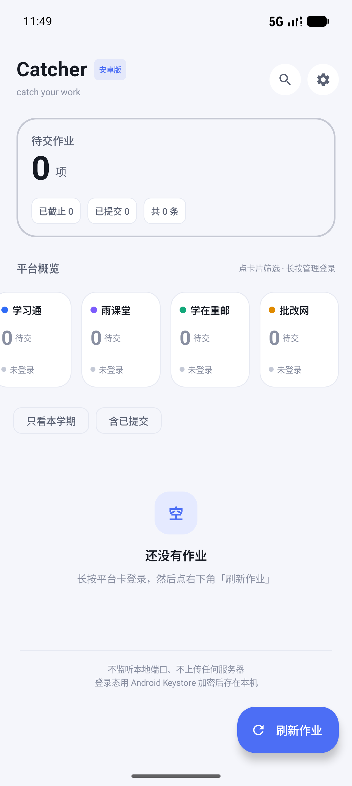
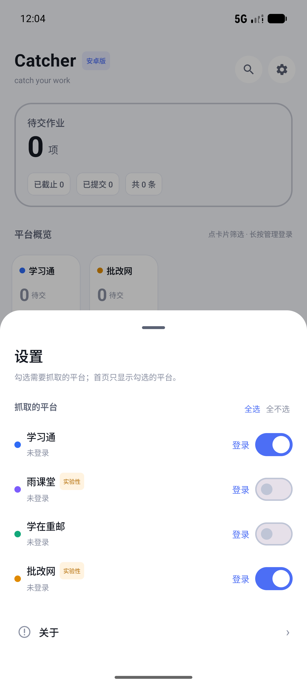
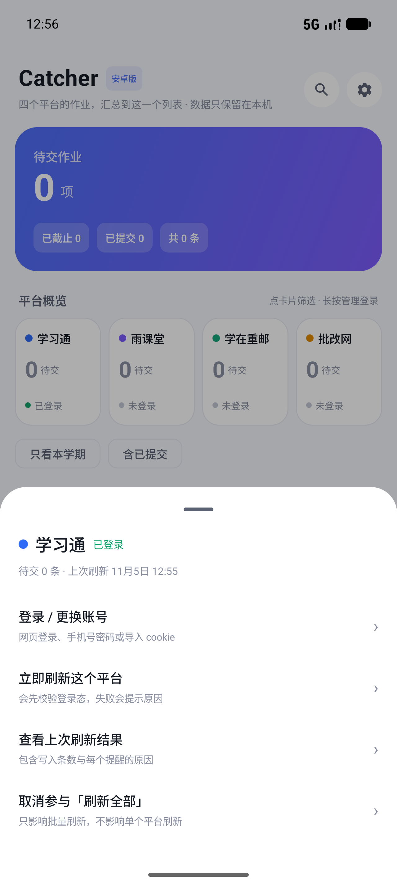
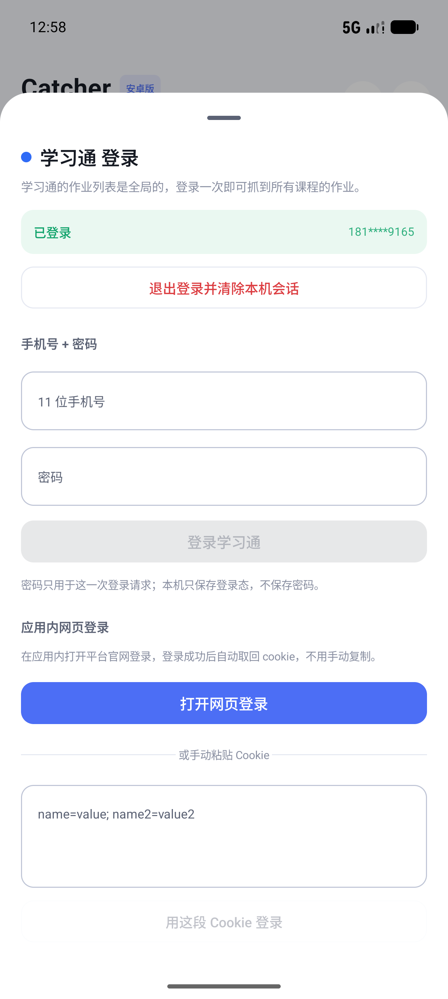
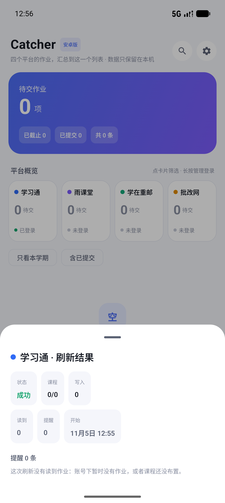
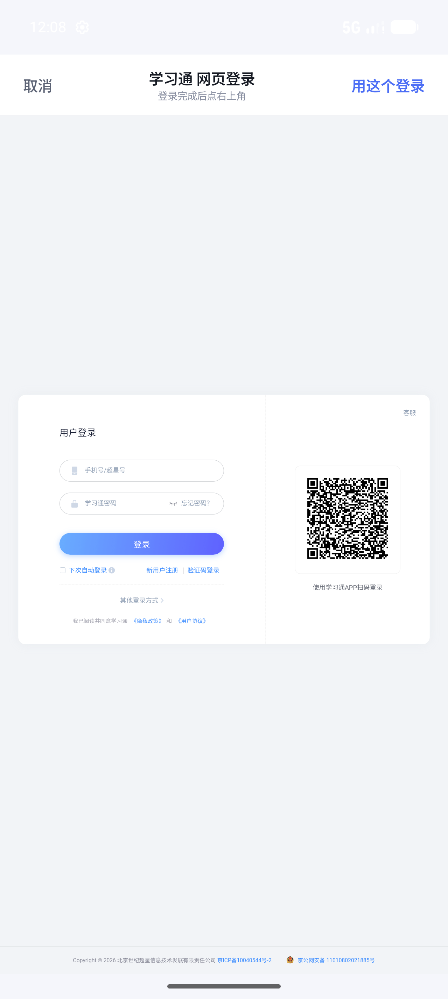
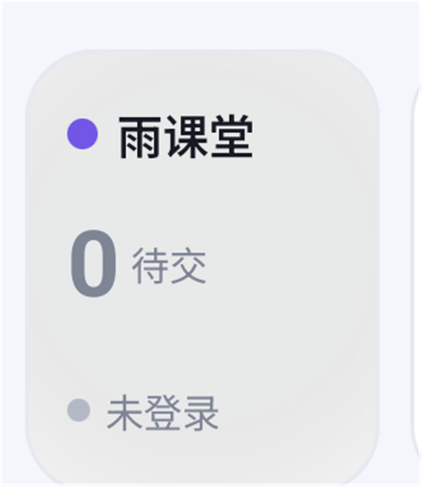

# Catcher

把**雨课堂、学习通、学在重邮、批改网**四个平台的作业抓到一个列表里的安卓应用。

按 [Catcher 电脑端](https://github.com/jiajia-jun/catcher)（Go + Wails，v1.3.0）的原理重写：同样的分层、同样的抓取规则、同样的「快照 + 软删除」持久化策略，登录态同样只留在本机。

<p align="center">
  
</p>

| | | |
|---|---|---|
|  |  |  |
| 首页：汇总 + 平台概览 + 按截止时间分组的作业 | 设置：勾选抓取的平台、平台登录 | 长按平台卡：登录 / 刷新 / 查看刷新结果 |
|  |  |  |
| 登录：手机号密码 / 网页登录 / 导入 cookie | 每次刷新都留下可解释的结果 | 应用内网页登录（真实打开学习通登录页） |

## 功能

- **统一作业表**：平台、课程、状态（已提交 / 未提交 / 未知）、截止时间与**时间来源**都摆在一条里
- **按截止时间分组**：已过截止 / 今天 / 明天 / 本周内 / 更晚 / 没有截止时间
- **平台概览卡（横向滑动）**：只显示设置里勾选的平台，点卡片单选该平台、只看它的作业，再点取消回到全部；角标是待交数量，平台多了可横向滑动查看
- **单平台刷新**：四个平台各自独立任务，可单独取消，进度条走真实阶段（读课程 → 读作业 → 逐条详情）
- **刷新手记**：每次刷新落一条记录（读到 / 写入 / 提醒），每条提醒都能解释「为什么」
- **手动标记**：平台状态拿不到时可以自己标「已提交 / 未提交」，随时恢复平台原值
- **搜索**：标题或课程名，大小写不敏感
- **只看本学期 / 含已提交**：主界面一键筛选，学期按每年 9 月 1 日划线
- **数据只在本机**：不监听端口、没有中转服务器、不上传任何数据



## 与电脑端的对照

### 分层

| 电脑端（Go） | 安卓端（Kotlin） | 作用 |
| --- | --- | --- |
| `main.go` + `cmd/app` | `CatcherApp.kt` / `AppContainer` | 依赖装配：http 引擎、四个适配器、本地库、凭据加密 |
| `internal/handle`（Wails 绑定） | `ui/HomeViewModel.kt` | 界面状态机，等价于原来的接口层 + 前端 store |
| `internal/service` | `data/CatcherRepository.kt` | 用例编排：刷新流程、登录、快照写入 |
| `internal/domain/entity` | `domain/model/*.kt` | 领域模型与三态状态、去重键、时间来源 |
| `internal/domain/port.go` | `domain/Ports.kt` | `Fetcher` / `PasswordAuthenticator` / `SessionImporter` / `CookieImporter` |
| `internal/infra/bridge/*` | `data/remote/{chaoxing,yuketang,tronclass,pigai}` | 四个平台适配器 |
| `internal/infra/sqlite` | `data/db/`（SQLiteOpenHelper + DAO） | 快照 upsert、软删除、刷新记录 |
| `internal/infra/secretstore`（DPAPI） | `data/secret/SecretVault`（Android Keystore） | 会话加密，只对本机本应用可解 |
| `internal/infra/sender` | `data/remote/HttpEngine` | 恒不跟随重定向的 HTTP 层 + 平台内全局 cookie 袋 |
| `frontend/src/**`（Vue） | `ui/**`（Jetpack Compose） | 界面 |

### 抓取规则

四条平台规则是**逐条照搬**的，包括注释里写明的那些「坑」：

| 平台 | 关键规则 |
| --- | --- |
| 学习通 | 登录在 `passport2`、数据在 `mooc1-api`，域名分裂；登录手工跟随 ≤10 跳并逐跳累积 `Set-Cookie`；登录态只看课程列表的 `result`，不看 HTTP 200；状态与剩余时间只从 `aria-label` 取、三个定界符**从右往左**找；`redPoint` 是未读标记不是未交；课程 id 按原始字面量保存 |
| 雨课堂 | 登录态只看响应体 `op == "web_redirect"`；`activities` 是**按日期分组的嵌套数组**，必须摊平；`score_d` 是 13 位毫秒、`create_time` 是 10 位秒；提交状态平台没暴露，一律 `unknown` |
| 学在重邮 | 站点只监听 80（明文，已用 `network_security_config` 精确放行）；每个 200 都会轮换 `session`，但 401/302 下发的匿名 session 绝不覆盖已存值；翻页只能用 `pages` 终止；作业项没有 `course_id`，课程归属从请求 URL 带出 |
| 批改网 | HTTP 恒为 200，成败只看信封里的 `error`（`302` = 未登录）；必须带桌面 UA 与 `_display=json`；`_JUKU_USER` 整体当不透明凭据回放、不解析；详情只解析白名单字段（老师的密码摘要、邮箱、IP、CSRF 一律不建模）；截止时间是 10 位 Unix 秒，`"0"` 表示未设置；只抓第一页 → `partialByDesign` |

### 持久化

与电脑端 `internal/infra/sqlite/migrations/001_init.sql` 同构的 6 张表：
`accounts` / `sessions` / `credentials` / `fetch_runs` / `fetch_issues` / `courses` / `assignments`。

唯一编码差异：电脑端时间列存 RFC3339 文本，安卓端存 epoch millis（更好比较、不受时区影响），语义一致。

写入永远是**快照式**：

```
upsert 课程 → upsert 作业（按 (account_id, platform, dedup_key) 去重，手动状态不被覆盖）
  ├─ complete            → 本次没见到的作业 active = 0（软删除）
  ├─ 课程列表完整但部分课程失败 → 只清理没失败课程下的作业
  └─ 其余情况            → 只 upsert，保留历史数据
```

所以「平台暂时只返回半页」不会把已有作业删掉。

### 移动端的适配差异

| 电脑端 | 安卓端 | 原因 |
| --- | --- | --- |
| 本地窗口显示二维码，手机扫 | **应用内 WebView 登录 → 取 Cookie** | 手机上没法扫自己的屏幕；登录仍发生在平台官方页面，应用不接触账号密码 |
| 学习通：扫码 或 手机号+密码 | 手机号 + 密码（原生接口，AES-128-CBC 加密表单）+ 网页登录兜底 | 密码登录在移动端最直接，保留原接口 |
| 学在重邮：导入浏览器 session | 同左（也可从网页登录里取） | 平台不支持 CAS 自动登录 |
| 批改网：微信扫码 | 网页登录扫码（同一张微信二维码） | 同上 |
| DPAPI 加密 | Android Keystore（AES-GCM，密钥在 TEE） | 系统等价的「只对当前用户可解」 |

## 构建与运行

环境：Android Studio 2026.1.1（AGP 9.2.1、Gradle 9.4.1、JDK 21）、SDK Platform 36.1、minSdk 28。

1. Android Studio → `File → Open` → 选这个目录
2. 首次同步会自动补齐 Gradle / 依赖（`local.properties` 里 `sdk.dir` 指向本机 SDK）
3. 选 `Pixel_10_Pro` 虚拟机 → Run

命令行：

```powershell
$env:JAVA_HOME = 'D:\Android cast\jbr'

.\gradlew.bat assembleRelease     # 成品：app\build\outputs\apk\release\app-release.apk
.\gradlew.bat assembleDebug       # 调试包

adb install -r app\build\outputs\apk\release\app-release.apk
```

> **签名**：第一版的 release 包用调试证书（`signingConfig = debug`）签名，装到任何机器上都能直接跑。
> 要正式发布时，生成自己的 keystore、在 `app/build.gradle.kts` 里加 `signingConfigs`，把 release 的
> `signingConfig` 指向它；同时把 `optimization { enable = false }` 改为开启缩减与混淆（需要给 OkHttp 配 keep 规则）。
> 第一版先不开 R8 缩减，是为了保证 release 包的行为和调试包完全一致。

## 验证记录（真实账号）

用一个真实学习通账号（11 位手机号 + 密码）在 `Pixel_10_Pro` 上跑过：

| 环节 | 结果 |
| --- | --- |
| 手机号 + 密码登录（AES 表单 → `passport2/fanyalogin`） | ✅ `{"status":true}`，拿到 14 个 cookie，界面提示「学习通：登录成功」 |
| 会话落库 + 重装应用后仍可用 | ✅ 升级安装后平台卡仍显示「已登录」，Keystore 解密正常 |
| 课程列表 `backclazzdata` | ✅ HTTP 200、`result:1`（登录态有效）；该账号 `channelList: []` |
| 作业列表 `stu-work` | ✅ HTTP 200，页面为 `暂无作业`，`haveMore=0` |
| 快照写入 + 软删除 | ✅ 读到 0 条、写入 0 条，刷新记录状态「成功」 |
| 断网 / DNS 异常时的提示 | ✅ 登录面板直接显示「网络请求失败: Unable to resolve host …」，恢复后重试即成功 |

这次实测抓到并修掉了一个**从电脑端继承来的缺陷**：

> 电脑端 `parseWorkList` 用 `body.contains("goTask")` 判断「页面结构是否变化」。
> 但作业列表页里永远有 `function goTask(obj){...}` 的定义，所以**任何空列表账号**都会被误报成
> 「页面结构可能已变化」，并把这次刷新标成部分成功、禁止软删除。
> 安卓端改成只认条目标记 `<li onclick="goTask`，并识别「暂无作业」空状态；
> 同时补了两个回归用例（空列表不报警告 / 有条目标记却解析不出才报）。

另外两个只在真机上才会暴露的问题也一并修了：

- **网络抖一下就整次刷新失败**：手机换 Wi-Fi、DNS 抖动很常见，现在对 `NETWORK` 类错误重试一次（认证/解析/取消不重试）
- **网络失败时平台卡显示「未登录」**：会让用户以为要重新登录，现在如实区分「已登录 / 未登录 / 需要重新登录 / 登录异常，可重试」

> 这个账号在**学习通全国平台**上目前没有课程也没有作业（`channelList` 为空、个人空间无课程卡），
> 所以「解析一条真实作业条目」这一步仍然没有真实样本可验证——解析规则目前由单测里的仿真页守着。

## 单元测试

`app/src/test/java/` 下有 29 个用例，锁住最容易被「顺手优化坏」的规则：

- `ChaoxingCryptoTest`：登录表单 AES-128-CBC 的输出与电脑端**逐字节一致**（期望值按同一套参数独立算出）
- `ChaoxingHtmlTest`：`aria-label` 从右往左拆、状态三态、剩余时间换算、`&amp;` 反转义、年份推断、空列表不误报
- `AssignmentQueryTest`：默认隐藏已提交、平台/关键词筛选、分组、学期起点、平台角标

```powershell
.\gradlew.bat testDebugUnitTest
```

> 注意：当前项目路径是 `C:\Users\wu'si\Desktop\Catcher-Android`，路径里的撇号会让 Gradle 9 的测试 worker
> 起不来（`ClassNotFoundException: worker.org.gradle.process.internal.worker.GradleWorkerMain`）。
> 这是本机工具链的问题，和代码无关，`assembleDebug` / `assembleRelease` 都不受影响。
> 想跑测试可以把项目复制到不含撇号的路径（例如 `D:\Catcher-Android`），或者用
> `java -cp <classes> org.junit.runner.JUnitCore ...` 直接跑（29 个用例全部通过）。

## 已知限制

- **「解析真实作业条目」仍无真实样本验证**：真实账号登录、接口、快照、软删除都跑通了，但这个账号没有作业，所以 `aria-label` 拆分、剩余时间换算这些只在仿真页面 + 单测上验证过
- 批改网只抓列表第一页（与电脑端一致），作业多时可能漏掉更早的记录
- 雨课堂、批改网在电脑端就是**实验性**功能，安卓端同样标注
- 学在重邮只支持 session 导入，失效后需要重新导入
- 学习通的作业列表 `haveMore != 0` 时不做软删除（翻页参数未验证，与电脑端一致）
- 没有后台定时刷新：打开应用点刷新才会抓

## 隐私

- 登录态（cookie / session）用 Android Keystore 的 AES-GCM 加密后存进本机 SQLite，只对本应用可解；解密失败直接要求重新登录，**不回退明文**
- 密码只用于那一次登录请求，不落库、不进日志
- 日志与界面都不打印 Cookie、密码、session 值
- 应用**不监听任何端口**，只有主动发出的出站请求；没有中转服务器
- 学在重邮的校园站点只开放 HTTP，`network_security_config` 里只对 `lms.tc.cqupt.edu.cn` 放行明文，其余域名强制 TLS

## 免责声明

非官方个人学习项目，与雨课堂、学习通、学在重邮、批改网及其运营方没有任何关联。
接口依据公开页面抓包整理，仅用于学习与技术研究；接口及相关内容归各平台所有。
使用者应自行遵守各平台的用户协议与所在地法律法规。项目按 MIT 许可证「按现状」提供。
